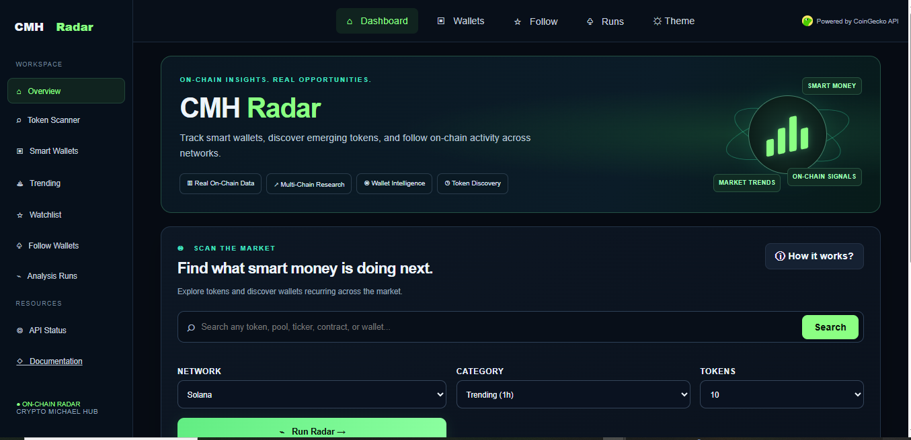
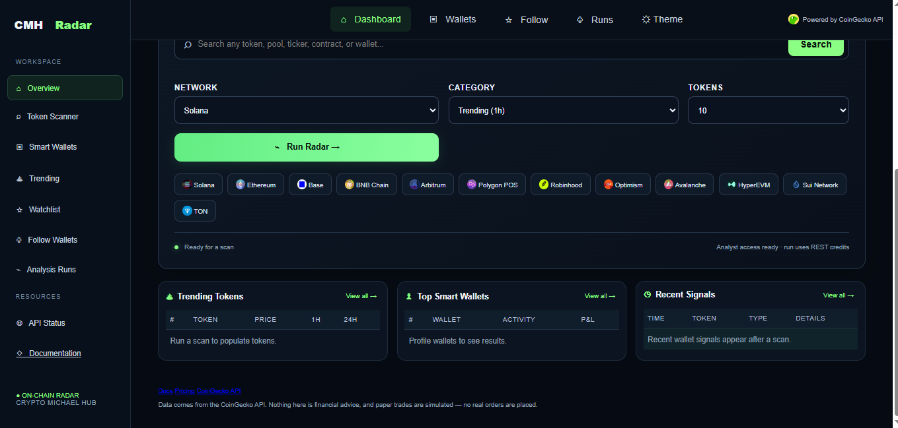

<picture>
  <source media="(prefers-color-scheme: dark)" srcset="core/brand/coingecko-api-on-dark.svg">
</picture>

# CMH Radar

CMH Radar is a crypto market and wallet intelligence project built on CoinGecko API data. It brings together token discovery, wallet analysis, scoring, and paper-trading tools in one customizable workflow.

The project explores how market data and wallet activity can be used to evaluate tokens and analyze trading strategies.


## CMH Radar Dashboard

### Dashboard Overview



### Dashboard Details




## Features

- **Token discovery:** Explore trending tokens and newly created liquidity pools.
- **Wallet analysis:** Review supported wallet performance, trade history, and balances.
- **Wallet scoring:** Evaluate wallets using repository-defined performance and copyability metrics.
- **Strategy testing:** Backtest selection rules and review historical results.
- **Paper trading:** Simulate trading decisions without executing real transactions.
- **Reporting:** Generate reports from recorded analysis runs.

Feature availability depends on the configured CoinGecko API plan and supported network endpoints.

## Requirements

- Python 3.12
- [uv](https://docs.astral.sh/uv/)
- A CoinGecko API key with access to the endpoints you intend to use

Get an API key from the [CoinGecko API platform](https://www.coingecko.com/en/api).

## Installation

Clone this repository and enter the project directory:

```bash
git clone https://github.com/cmichaelhub/CMH-RADAR.git
cd CMH-RADAR
```

Install the dependencies:

```bash
make install
```

Create your local environment file:

```bash
cp env.example .env
```

Add your API key to `.env`, then start the application:

```bash
make run
```

Open [http://localhost:8000](http://localhost:8000) in your browser.

Keep API keys and other credentials private. Never commit your `.env` file.

## How it works

CMH Radar combines token and pool discovery with supported wallet data. Repository-defined scoring and strategy rules analyze the collected information, while backtesting and paper-trading components let users evaluate decisions without placing real trades.

CoinGecko provides the underlying API data. Scores, labels, rankings, strategy outputs, and paper-trading decisions are generated by the application and are not official CoinGecko classifications.

## Data and limitations

Available data varies by network, endpoint, and API plan. Wallet balances, transfers, performance metrics, and trade history may have different levels of coverage across supported chains.

Review the returned data and the implementation's scoring assumptions before relying on analytical results.

## Important disclaimer

CMH Radar is an analytical and educational software project. Paper-trading results are simulations, not guarantees of future performance. The project does not provide financial advice, and its paper-trading functionality does not execute real trades.

## Acknowledgements

CMH Radar builds on an existing Smart Money Radar codebase. Credit and applicable license notices for the original project and its contributors should be preserved.

Market and wallet data are provided through the CoinGecko API.

## Resources

- [CoinGecko API](https://www.coingecko.com/en/api)
- [CoinGecko API documentation](https://docs.coingecko.com/)
- [CoinGecko API pricing](https://www.coingecko.com/en/api/pricing)
